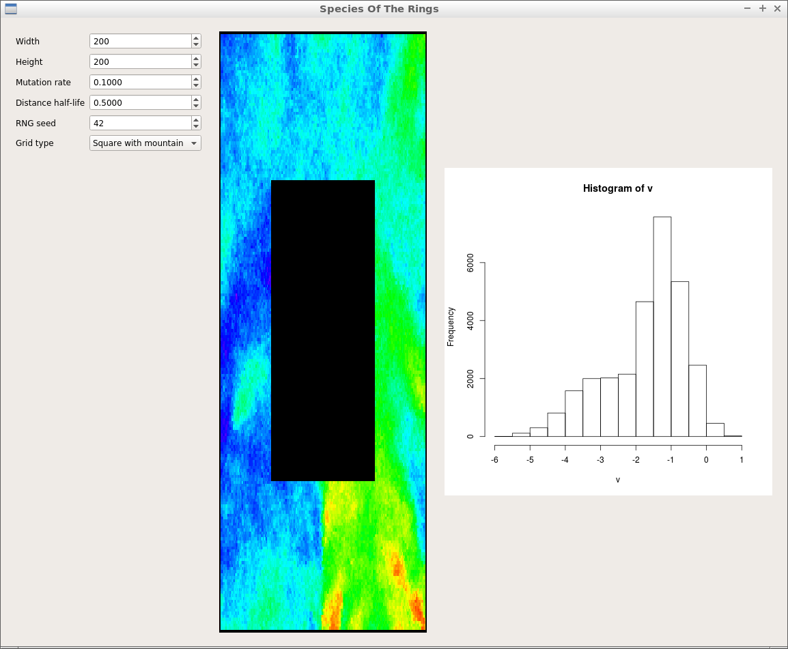

# SpeciesOfTheRings

[Go to the nicely rendered
website](https://richelbilderbeek.github.io/SpeciesOfTheRings/).

Spatial simulation about ring species in C++ using Qt.

## Video's

* The formation of a ring species:
  [.ogv](http://richelbilderbeek.nl/SpeciesOfTheRings42.ogv)
  [YouTube](https://youtu.be/rSGARz6_83Q)
